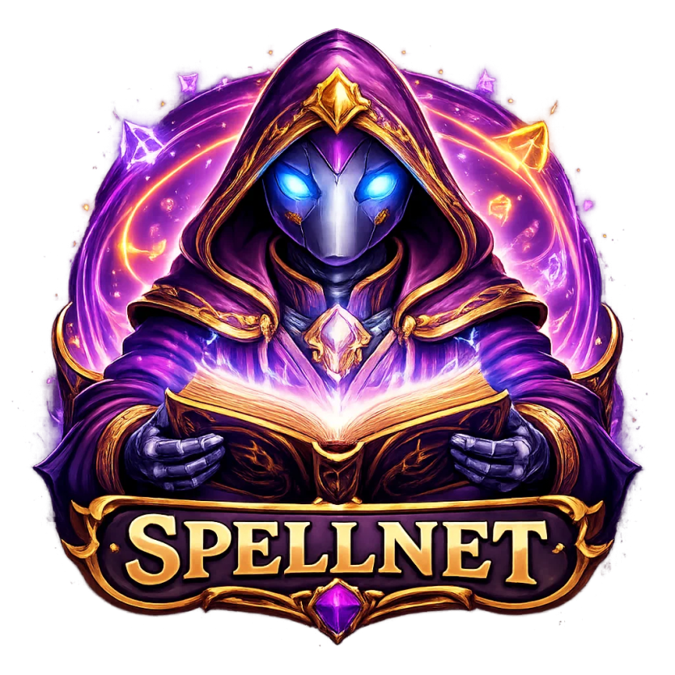
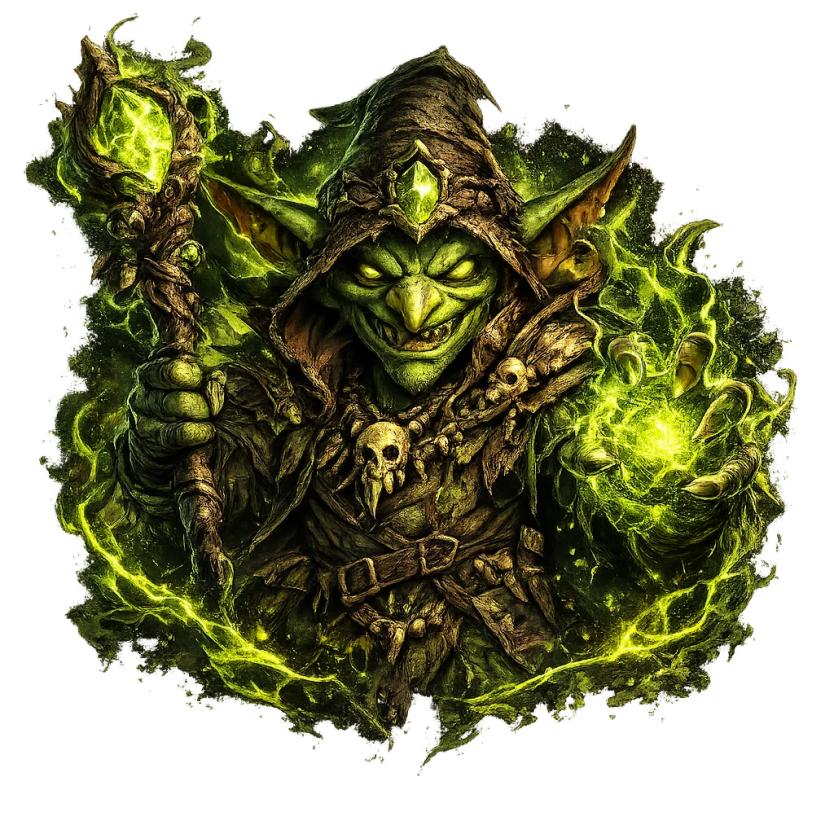

# SpellNet — Grimorio Inteligente RAG

<p align="center">
  
</p>

<p align="center">
  <a href="https://nodejs.org/"></a>
  <a href="https://reactjs.org/"></a>
  <a href="https://www.typescriptlang.org/"></a>
  <a href="https://expressjs.com/"></a>
  <a href="https://www.mysql.com/"></a>
  <a href="https://tailwindcss.com/"></a>
  <a href="https://socket.io/"></a>
  <a href="https://vitejs.dev/"></a>
  <a href="https://ollama.com/"></a>
</p>

---

SpellNet es una plataforma RAG (_Retrieval-Augmented Generation_) que permite cargar documentos propios y consultarlos mediante lenguaje natural. Integra Ollama para ejecutar modelos localmente y ChromaDB para almacenar vectores y recuperar fragmentos relevantes de los documentos.

---

## Arquitectura del proyecto

```text
/
├── assets/                     # Recursos gráficos del README
├── frontend/                   # Aplicación frontend
│   ├── public/
│   │   └── img/                # Recursos gráficos estáticos
│   └── src/
│       ├── components/         # Componentes reutilizables
│       ├── pages/              # Vistas y páginas
│       ├── index.css
│       ├── main.tsx
│       └── App.tsx             # Configuración de rutas
├── backend/                    # Servidor Node.js
│   ├── docs/                   # Documentos indexados por la IA
│   ├── migrations/             # Migraciones de base de datos
│   ├── models/                 # Modelos de datos
│   ├── scripts/
│   │   ├── main.ts
│   │   └── ingest.ts           # Script de ingesta de documentos
│   ├── src/
│   │   ├── db.ts
│   │   ├── index.ts
│   │   ├── server.ts
│   │   └── routes/
│   ├── knexfile.ts
│   └── package.json
├── shared/
│   └── types/                  # Tipos e interfaces compartidos
├── .gitignore
├── package.json
└── README.md
```

---

## Requisitos previos

- **Node.js** v20 o superior
- **npm**
- **Git**
- **Ollama** instalado y configurado
- **Docker** y **Docker Compose** (para la base de datos MySQL)
- Sistema operativo compatible: Linux, macOS o Windows

---

## Instalación

Clona el repositorio e instala las dependencias:

```bash
git clone https://github.com/Mohamed-DKW/SpellNet.git
cd SpellNet
npm run install:all
```

---

## Configuración de los servicios (Docker)

SpellNet necesita MySQL para los datos de la aplicación y ChromaDB para los vectores de búsqueda semántica. Ambos servicios se ejecutan en contenedores Docker independientes. MySQL crea la base de datos `spellnet` automáticamente al arrancar.

### Linux

> Probado en Fedora 43. Los pasos son equivalentes en otras distribuciones, adaptando el gestor de paquetes.

**1. Instalar Docker Engine**

```bash
sudo dnf install dnf5-plugins -y
sudo dnf config-manager addrepo --from-repofile=https://download.docker.com/linux/fedora/docker-ce.repo
sudo dnf install docker-ce docker-ce-cli containerd.io docker-compose-plugin -y

sudo systemctl start docker
sudo systemctl enable docker

# Opcional: evitar usar sudo en cada comando Docker
sudo usermod -aG docker $USER
newgrp docker

docker --version
```

**2. Configurar las variables de entorno**

```bash
cp backend/.env.example backend/.env
```

Contenido de `backend/.env`:

```env
DB_HOST=127.0.0.1
DB_PORT=3306
DB_USER=root
DB_PASSWORD=1234
DB_NAME=spellnet
CHROMA_URL=http://localhost:8000
OLLAMA_URL=http://localhost:11434
OLLAMA_MODEL=gemma2:2b
```

**3. Levantar MySQL y ChromaDB**

```bash
cd backend/mysql
docker compose up -d

cd ../chromadb
docker compose up -d
```

MySQL queda disponible en `localhost:3306` y ChromaDB en `http://localhost:8000`. Comprueba que ambos contenedores estén activos con `docker ps`. Para verificar ChromaDB, abre `http://localhost:8000/api/v2/heartbeat`.

**4. Ejecutar las migraciones de MySQL**

```bash
cd ..
npm run migrate
```

> ChromaDB no necesita migraciones manuales. El backend crea las colecciones al indexar documentos y el volumen Docker `chroma_data` conserva los vectores entre reinicios.

---

### Windows

**1. Instalar Docker Desktop**

Descarga e instala [Docker Desktop para Windows](https://www.docker.com/products/docker-desktop/). Requiere Windows 10/11 de 64 bits con WSL 2 y virtualización habilitada en BIOS.

**2. Configurar las variables de entorno**

Crea o edita `backend/.env`:

```env
DB_HOST=127.0.0.1
DB_PORT=3306
DB_USER=root
DB_PASSWORD=1234
DB_NAME=spellnet
CHROMA_URL=http://localhost:8000
OLLAMA_URL=http://localhost:11434
OLLAMA_MODEL=gemma2:2b
```

**3. Levantar MySQL y ChromaDB**

```powershell
cd backend\mysql
docker compose up -d

cd ..\chromadb
docker compose up -d
```

MySQL queda disponible en `localhost:3306` y ChromaDB en `http://localhost:8000`. Comprueba los contenedores con `docker ps`; el endpoint `http://localhost:8000/api/v2/heartbeat` verifica que ChromaDB responde.

**4. Ejecutar las migraciones de MySQL**

```powershell
cd ..
npm run migrate
```

> ChromaDB no necesita migraciones manuales. El volumen Docker `chroma_data` conserva los vectores entre reinicios.

---

**Comandos útiles de Docker:**

```bash
docker compose logs -f        # Ver logs del contenedor
docker compose down           # Detener el contenedor
docker compose down -v        # Detener y eliminar los datos
```

---

## Configuración de Ollama

SpellNet usa **Gemma 2 2B** (`gemma2:2b`) para el chat y **`nomic-embed-text`** para generar embeddings en el servicio RAG. Ollama no los descarga automáticamente; instálalo y descarga ambos modelos una vez. La configuración local se crea copiando `backend/.env.example` a `backend/.env`, archivo que Git ignora.

```bash
# Instalar Ollama
sudo -v && curl -fsSL https://ollama.com/install.sh | sh

# Descargar los modelos que usa SpellNet
ollama pull gemma2:2b
ollama pull nomic-embed-text

# Iniciar el servicio si no está activo
ollama serve
```

En Windows, instala Ollama desde [ollama.com/download/windows](https://ollama.com/download/windows), abre una nueva ventana de PowerShell y ejecuta los mismos comandos `ollama pull`.

Verifica que el modelo esté disponible:

```bash
ollama list
# Deberías ver: gemma2:2b y nomic-embed-text
```

---

## Ejecución

### Opción 1: Visual Studio Code (recomendado)

1. Abre el proyecto en VSCode.
2. Ve al panel Debug (`Ctrl+Shift+D`).
3. Selecciona **"Start App"** en el desplegable.
4. Pulsa el botón de play o `F5`.

### Opción 2: Terminal

```bash
# Inicia backend y frontend en paralelo
npm run dev

# O por separado:
cd backend && npm run dev   # Terminal 1
cd frontend && npm run dev  # Terminal 2
```

Una vez en marcha:

- Frontend: [http://localhost:3000](http://localhost:3000)
- Backend API: [http://localhost:3001/api/health](http://localhost:3001/api/health)

---


### Interfaz web

Accede a [http://localhost:3000](http://localhost:3000) y navega a las secciones **Chat** y **Documentos**.

### Flujo completo del sistema

1. Carga documentos (PDF/TXT)
2. SpellNet genera embeddings con Ollama
3. Los vectores se almacenan en la base de datos
4. Al hacer una pregunta, se realiza búsqueda semántica sobre los documentos
5. El modelo Gemma genera una respuesta contextualizada

---

## 🏰 Planes

> Los planes de SpellNet están inspirados en _Dungeons & Dragons_, pensados para escalar según el nivel de uso.

### Goblin — Gratis / mes



- 10 mensajes diarios
- 1 archivo diario

### Wizard — $20 / mes


- 30 mensajes diarios
- Hasta 5 archivos diarios

### Elder Dragon — $50 / mes


- Mensajes ilimitados
- Archivos ilimitados

---

## Tecnologías

**Frontend**

- React + TypeScript + Vite
- Tailwind CSS

**Backend**

- Express.js
- MySQL
- Knex.js + Objection.js
- Multer, JWT, bcrypt

**IA y utilidades**

- Ollama (Gemma 2 2B) — modelo de lenguaje local

**Herramientas de desarrollo**

- TypeScript, ts-node, nodemon, concurrently

---

## Equipo

| Nombre           | Perfil / Redes                                                                             |
| ---------------- | ------------------------------------------------------------------------------------------ |
| Mahamadu Dukuray | [@Mohamed-DKW](https://github.com/Mohamed-DKW) / [@mahamadu.dukuray.waggeh](https://gitlab.com/mahamadu.dukuray.waggeh) |
| Rafael Eduardo   | [@rafael.martinez5](https://gitlab.com/rafael.martinez5)                                   |
| Andrea Valverde  | [@andrea.valverde.martinez.2005](https://gitlab.com/andrea.valverde.martinez.2005)         |

**Profesor:** Albert Milian — [@amilian51](https://gitlab.com/amilian51)

---

_Que tus consultas sean sabias y tus respuestas legendarias._ 🐉
